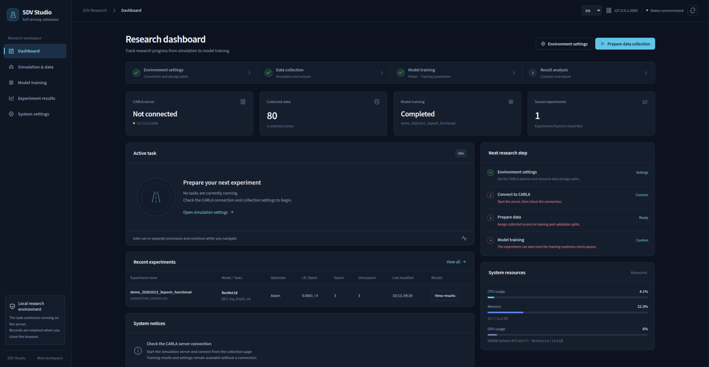

# SDV Studio



*Actual English main dashboard after the 13 October 2026 functional demonstration. The 80 samples and completed three-epoch run verify execution, not convergence.*

A local workspace for autonomous driving research: configure CARLA, collect aligned sensor data, prepare scene-based datasets, train perception tasks, and inspect saved metrics and predictions.

Use the app's **KO / EN** selector to switch languages.

[한국어](README_ko.md) · [Step-by-step guide with real screenshots](docs/USER_GUIDE.md) · [Setup and assets](docs/SETUP.md) · [Repository map](docs/REPOSITORY_LAYOUT.md)

## Start

```bash
./start.sh
```

Open [http://127.0.0.1:8765](http://127.0.0.1:8765). The launcher creates a separate web environment and installs its dependencies; Python 3.7+ is supported. Use **Settings** to connect your existing CARLA/PyTorch Python and CARLA 0.9.15 installation. The web environment does not install research CUDA/PyTorch packages. See [setup](docs/SETUP.md) before collection or training.

## How to use it

1. **Settings:** select the research interpreter, CARLA path and storage paths; save and run diagnostics. Keep the verified **Epic + Off-screen** profile.
2. **Simulation → Collection / Sensors:** choose towns, sample counts, driving policy and sensors; save, start CARLA and check readiness.
3. **Start collection:** inspect actual saved-sample progress and previews; confirm the completed job.
4. **Sequences / Dataset:** select complete scenes for TRAIN and VAL, prepare a copied dataset, and use saved-data playback to check aligned RGB/Seg/Depth/OD/BEV frames.
5. **Training → Setup:** select the dataset, model, tasks, losses and parameters; check readiness, then start or queue training.
6. **Monitoring / Results:** inspect TRAIN/VAL legends, saved Epoch/Iteration predictions and checkpoints. Compare only compatible dataset fingerprints.

[Follow each action and expected result in the illustrated guide →](docs/USER_GUIDE.md)

## Repository map

| Path | Role |
| --- | --- |
| `studio/` | Current web UI, API, job supervisor and local records |
| `sdv/` | Current collection, BEV, driving, training and desktop implementation |
| `configs/`, `requirements/` | Configuration examples/evaluation scenarios and dependency groups |
| `scripts/`, `tests/` | Validation commands and regression tests |
| `docs/` | Current guides, validation reports, real screenshots and historical documents |
| `legacy/` | Preserved earlier collector/model/helper source and desktop fixtures |

Root Python scripts, `train_model/`, `carla_data_gan/`, `utils.py` and the small requirements includes remain compatibility bridges. [Exact entrypoints and migration map](docs/REPOSITORY_LAYOUT.md) explain which implementation each command uses. `trainx2.py` refers to an experiment absent from the supplied ZIP; use the supported Studio trainer.

[Cleanup verification and remaining visual checks](docs/CLEANUP_VALIDATION_KO.md)

## Assets and validation scope

Supply **CARLA, matching Python API, research dependencies, your datasets/calibration, licensed BEV map assets with their catalog, and a compatible Roach checkpoint** separately. They are not included in this repository. [Setup instructions](docs/SETUP.md) list the expected paths and checks.

The 13 October run collected **80 samples**, prepared **TRAIN 40 / VAL 40 by separate scenes**, and finished **3 epochs / global step 30** with **252 prediction records**. Final VAL segmentation mIoU was **0.0341**, depth RMSE **24.846 m**, and BEV mean IoU **0**; VAL had **no positive object boxes**. These values demonstrate execution and recording only. They do not establish detection quality, convergence, or generalization. [Evidence and screenshot provenance](docs/SCREENSHOT_EVIDENCE.md).

Supplied map PNGs lack precise metric road elevation; validity masks and **N/A** remain meaningful. Low rendering caused a UE4 Landscape SIGSEGV on the verified host. See [CARLA stability](docs/CARLA_STABILITY_KO.md), [training follow-up](docs/TRAINING_UI_FOLLOWUP_KO.md), [BEV contracts](docs/GLOBAL_MAP_INTEGRATION_KO.md) and [development checks](docs/development.md).

MIT code license: [LICENSE](LICENSE). Upstream notices: [THIRD_PARTY_NOTICES](THIRD_PARTY_NOTICES). Map/checkpoint redistribution rights are separate; bundled Noto Sans KR fonts retain their SIL Open Font License.
