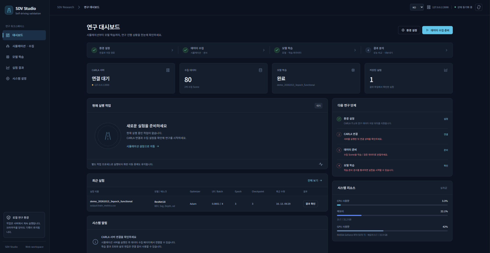

# SDV Studio



*2026년 10월 13일 기능 시연 후의 실제 한국어 메인 화면입니다. 80개 수집 샘플과 3 Epoch 학습 완료는 수렴 성능의 근거가 아닙니다.*

CARLA 설정 → 정렬된 센서 데이터 수집 → 장면 단위 데이터셋 준비 → 인지 태스크 학습 → 저장 지표·예측 확인으로 이어지는 로컬 자율주행 연구 작업 공간입니다.

앱 우측 상단 **KO / EN**에서 언어를 바꿀 수 있습니다.

[English](README.md) · [실제 사진으로 따라 하는 단계별 안내](docs/USER_GUIDE_KO.md) · [환경·자산 준비](docs/SETUP_KO.md) · [저장소 지도](docs/REPOSITORY_LAYOUT.md)

## 실행

```bash
./start.sh
```

[http://127.0.0.1:8765](http://127.0.0.1:8765)를 엽니다. 실행 스크립트는 별도 웹 가상환경을 만들고 웹 의존성을 설치합니다. Python 3.7 이상을 지원합니다. **시스템 설정**에서 기존 CARLA/PyTorch 연구 Python과 CARLA 0.9.15 설치 경로를 연결하세요. 웹 환경에 연구 CUDA/PyTorch 패키지를 설치하지 않습니다. 수집·학습 전 [환경 준비 안내](docs/SETUP_KO.md)를 확인하세요.

## 이렇게 사용합니다

1. **시스템 설정:** 연구 Python, CARLA 설치·저장 경로를 선택하고 저장한 뒤 진단합니다. 검증된 **Epic + Off-screen**을 유지합니다.
2. **시뮬레이션 → 수집 설정 / 센서 구성:** Town·샘플 수·주행 정책·센서를 선택해 저장하고, CARLA 실행 후 준비 상태를 검사합니다.
3. **데이터 수집 시작:** 실제 저장 샘플 수와 미리보기를 확인한 뒤 완료 상태를 확인합니다.
4. **시퀀스 분석 / 데이터셋:** 완전한 장면을 TRAIN·VAL로 나눠 원본을 보존하는 데이터셋을 준비합니다. 저장 데이터 재생에서 같은 Frame의 RGB/Seg/Depth/OD/BEV를 확인합니다.
5. **모델 학습 → 설정:** 데이터셋·모델·태스크·손실·파라미터를 정하고 준비 검사 후 학습을 시작하거나 대기열에 넣습니다.
6. **모니터링 / 실험 결과:** TRAIN·VAL 범례, 저장된 Epoch·Iteration 예측, 체크포인트를 확인합니다. 동일한 데이터셋 fingerprint를 가진 실험을 비교합니다.

[각 단계의 클릭과 확인할 결과를 실제 사진으로 따라 하기 →](docs/USER_GUIDE_KO.md)

## 저장소 지도

| 경로 | 역할 |
| --- | --- |
| `studio/` | 현재 웹 UI·API·작업 관리·로컬 기록 |
| `sdv/` | 현재 수집·BEV·주행·학습·데스크톱 구현 |
| `configs/`, `requirements/` | 설정 예제·평가 시나리오와 목적별 의존성 |
| `scripts/`, `tests/` | 검증 명령과 회귀검사 |
| `docs/` | 현재 안내·검증 보고·실제 사진·과거 문서 |
| `legacy/` | 보존한 이전 수집·모델·보조 코드와 데스크톱 예제 이미지 |

루트 Python 실행 파일, `train_model/`, `carla_data_gan/`, `utils.py`, 짧은 requirements 파일은 기존 명령·import를 위한 연결 파일입니다. [실행 경로·이동 목록](docs/REPOSITORY_LAYOUT.md)에서 연결 대상을 확인하세요. `trainx2.py`가 가리키는 실험은 제공 ZIP에 없으므로 지원하는 Studio 학습 경로를 사용합니다.

[정리 후보 검사와 남은 시각 확인](docs/CLEANUP_VALIDATION_KO.md)

## 자산과 검증 범위

**CARLA·일치하는 Python API·연구 의존성·원본 데이터/보정·라이선스를 확인한 BEV 지도와 catalog·호환 Roach 체크포인트**는 별도로 준비합니다. 저장소에는 포함하지 않습니다. [설치 안내](docs/SETUP_KO.md)에 경로와 확인 방법이 있습니다.

10월 13일 실제 실행은 **80샘플**, 별도 장면의 **TRAIN 40 / VAL 40**, **3 Epoch / Global step 30**, **예측 기록 252개**입니다. 마지막 VAL Seg mIoU **0.0341**, Depth RMSE **24.846 m**, BEV mean IoU **0**이며 VAL에는 **양성 객체 상자가 없습니다**. 실행·기록 기능을 확인한 수치로, 탐지 성능·수렴·일반화를 입증하지 않습니다. [증거·사진 출처](docs/SCREENSHOT_EVIDENCE.md).

제공 지도 PNG에는 정밀 미터 도로 높이가 없으므로 validity mask와 **N/A**를 유지합니다. 검증 PC의 Low 렌더링에서 UE4 Landscape SIGSEGV가 재현됐습니다. [CARLA 안정화](docs/CARLA_STABILITY_KO.md), [학습 후속 검증](docs/TRAINING_UI_FOLLOWUP_KO.md), [BEV 계약](docs/GLOBAL_MAP_INTEGRATION_KO.md), [개발 검사](docs/development_ko.md)를 확인하세요.

코드 MIT 라이선스: [LICENSE](LICENSE). 원본 출처: [THIRD_PARTY_NOTICES](THIRD_PARTY_NOTICES). 지도·가중치의 재배포 권한은 별도이며, 포함된 Noto Sans KR 글꼴은 원래 SIL Open Font License를 유지합니다.
