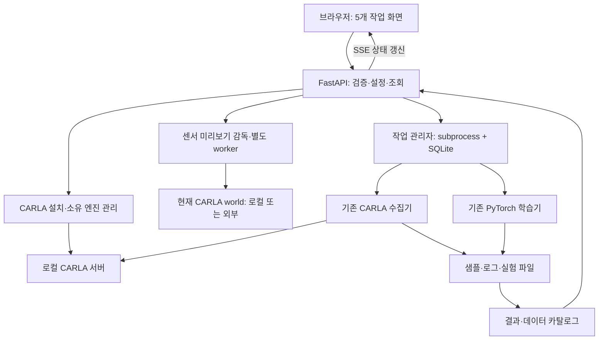

# SDV Studio 구현 구조

## 원본 분석

| 원본 경로 | 실제 역할 | 확인한 한계 / 통합 방향 |
|---|---|---|
| `start.py` → `sdv/ui/workflow.py` | Pygame 연구 관리 화면 | 관리 화면을 웹으로 대체. 기존 실행 경로는 보존 |
| `carla_run.py` → `sdv/collection/workflow.py` | CARLA 멀티모달 데이터 수집 | 자체 서버/90초 검증 제한과 별도로 외부 CARLA 연결 경로 추가 |
| `sdv/collection/carla_engine/` | 센서·주행·BEV rasterization | Pygame의 surfarray와 map rasterization은 유지 |
| `sdv/collection/preview.py`, `sdv/ui/workflow.py` | 데스크톱 센서 부착·영상 확인·좌표 편집 | 기존 경로를 보존하고 웹에 좌표 편집·실제 RGB/LiDAR를 연결 |
| `train.py`, `train2.py` → `sdv/training/` | 준비 검사·PyTorch 인지 모델 학습 | 원본 모델·손실식을 유지하며 경로, 상태, metric 출력 연결 |
| `sdv_web/core/models.py` | Django 작업 기록 | 원본 웹 보관. 새 실행 관리자에서 SQLite 영속 기록 관리 |
| `sdv_web/core/job_specs.py` | 학습 명령 생성 | 기본 mock 학습을 새 앱 실행 경로에서 제외 |
| `sdv_web/templates/data_collect.html`, `data_make.html` | 타이머 기반 수집 UI | 실제 수집기의 저장 이벤트로 대체 |
| `sdv_web/core/metric_utils.py` | 저장 metric 읽기 | 기존 metric 형식 호환을 새 결과 카탈로그에서 지원 |

기존 웹의 PPO/SAC/DQN, YOLO/BEVFormer 선택 항목, W&B 연결 문자열 검사는 실제 학습 구현을 뜻하지 않습니다. 새 앱에는 연구 코드에서 확인된 인지 모델 경로만 연결합니다. 독립적인 평가 실행기와 RL 학습기를 새로 발명하지 않습니다.

## 새 구조

FastAPI를 선택한 이유는 기존 Django 화면 상당수가 세션 설정과 모의 작업에 묶여 있어 실제 연구 프로세스 연결을 새로 구성해야 하기 때문입니다. 프론트엔드는 외부 CDN 없이 작동하는 정적 JavaScript 모듈과 CSS로 구성했습니다. 별도 Node 빌드 서버 없이 Python 서버 하나로 제공하며, 기존 Python 연구 환경을 별도 실행기로 지정할 수 있습니다.

## UI 구성

- Dashboard: 실제 CARLA 연결 상태, 활성 작업, 최근 실행, 다음 작업 안내, 시스템 자원.
- Simulation: 최상단 CARLA 설치·실행·중지·로그, 외부 서버 연결, 센서 좌표 숫자 입력·배치도 드래그와 실제 미리보기, 타운·수집 설정, 준비 검사, 수집 제어와 최신 저장 프레임.
- Training: 모델 학습 설정·모니터링·대기열의 3개 탭. 실제 데이터에 따른 입력 센서·태스크 선택, 모델 구성·파라미터·가중치 준비, 순서 변경과 Epoch 단위 일시정지/재개, 실제 태스크 지표·Best 표와 고정 표본 예측 기록.
- Results: 저장 실험 목록, 모델·Optimizer·파라미터 구분, 실제 metric 시계열·Best 표, 동일 데이터셋 Prediction 비교, checkpoint와 파일 내보내기.
- Settings: CARLA 주소, Python 실행 환경, 데이터·결과·로그 경로, 설정 가져오기·내보내기.

수집 화면의 카메라/BEV 영역은 수집기가 이미 저장한 프레임을 설정한 갱신 주기로 읽으며 저장 전에는 빈 상태를 표시합니다. 센서 설정 화면의 실제 미리보기는 별도 CARLA 센서로 생성합니다. 두 경로는 데이터 출처와 실행 수명이 다르며 수집과 센서 미리보기의 동시 실행을 허용하지 않습니다.

상단 KO/EN 선택은 `studio/static/i18n.js`의 정적 UI 번역을 사용합니다. 언어는 `localStorage`, 전환 시 복원할 폼 초안은 `sessionStorage`에 보존합니다. `app.js`가 전환 후 입력과 선택을 복원하며 서버 작업에는 중지 요청을 보내지 않습니다. 사용자 데이터·경로·실험 이름·원시 로그는 원문을 유지합니다.

## 센서 설정·실제 미리보기

`studio/static/sensor-preview.js`의 상단·측면 배치도는 현재 폼의 센서 좌표를 편집합니다. 점은 센서의 대략적인 위치를 나타내며 정확한 설정값은 숫자 좌표로 확인합니다. **프리뷰에 적용**은 초안을 미리보기 프로세스로 전달하고, **설정 저장**은 별도 센서 설정 API에 저장합니다. 미리보기 시작·적용만으로 수집 설정을 덮어쓰지 않습니다.

`studio/sensor_preview_service.py`는 `.runtime/studio/sensor-preview/`의 세션 상태·명령·로그와 worker 수명을 관리합니다. `sensor_preview_worker.py`는 선택한 연구 Python에서 실행하며 CARLA·NumPy·Pillow를 사용합니다. CARLA 센서 콜백이 만드는 실제 RGB·LiDAR 점군 JPEG를 제공합니다. 화면 이동은 브라우저 polling만 해제하며 프로세스 종료는 명시적 중지 또는 서버 종료가 담당합니다.

출력은 채널별 최신 JPEG만 원자적으로 교체하며 프레임을 무한히 쌓지 않습니다. 요청 FPS 기본값은 **24**, 입력은 **정수 1~60**입니다. 센서 `sensor_tick`, JPEG 발행과 브라우저 요청 주기에 반영하며 실제 수신·발행 빈도를 별도로 보고합니다. 실제 속도는 시뮬레이션 주기·GPU·인코딩·전송 성능을 넘지 못합니다. RGB 캡처는 긴 변 최대 **640 px**로 제한합니다. 설정 해상도와 실제 미리보기 캡처 해상도를 메타데이터에서 구분하고, 수집 설정의 해상도는 그대로 유지합니다. 적용 revision으로 새 설정의 출력인지 확인합니다. 프레임 번호·시각은 마지막 상태 조회 기준이며 개별 HTTP 이미지와 같은 순간의 원자적 스냅샷이라고 단정하지 않습니다.

worker는 `get_world()`로 현재 맵을 사용하며 `load_world()`나 world 설정 변경을 수행하지 않습니다. 앱 소유로 확인한 동기 CARLA에만 tick을 보내고, 외부 동기 서버는 외부 ticker를 요구합니다. 미리보기를 위해 생성한 센서·차량 ID만 정리하며 다른 액터나 외부 서버는 종료하지 않습니다. 미리보기 활성 상태에서는 수집·학습 시작, 엔진 종료, 연결 해제와 서버 주소·포트·연구 Python 변경을 API에서도 차단합니다. 브라우저 새로고침·언어 전환 뒤에는 서버 상태를 다시 읽습니다.

`sdv/collection/sensor_attributes.py`는 카메라 및 LiDAR blueprint 속성을 데스크톱 미리보기·웹 미리보기·실제 수집에 공통 적용합니다. 원래 LiDAR 생성 코드가 저장된 `channels`, `range`, `points_per_second`, `rotation_frequency`, `upper_fov`, `lower_fov`를 무시했기 때문에 설정과 실제 수집이 일치하도록 수정했습니다. 필드가 없으면 기존 고정값 또는 CARLA blueprint 기본값을 유지하며, 연구 좌표 변환·데이터 형식·모델 연산은 변경하지 않습니다.

이 구조와 경계 동작은 하드웨어 없이 검사할 수 있으나 실제 CARLA 센서 부착·프레임 수신·GPU 동작의 완료를 뜻하지 않습니다. 하드웨어 검증 범위는 [검증 문서](VALIDATION_KO.md)를 확인하세요.

## 학습 선택 가능 조건과 사전학습 가중치

`studio/training_options.py`는 저장 설정 또는 전달받은 경로 초안의 train/val을 읽습니다. 모든 장면의 `front_cam_rgb` 프레임을 기준으로 센서 RGB·LiDAR 및 선택 카메라의 Seg/Depth/OD 라벨 파일 ID와 크기를 검사합니다. BEV는 장면별 `bev` 또는 `das`·`lane`과 `vehicle_mask`·`walker_mask`가 필요하며 카메라 3개 이상 조건을 유지합니다. 부분 데이터나 빈 파일을 사용 가능으로 표시하지 않습니다. 이 경량 조회는 모델 라이브러리를 import하거나 이미지를 decode하지 않고, 한 요청 내에서 모달리티 목록을 재사용합니다. 자주 발생하는 SSE 갱신마다 전체 데이터를 다시 읽지 않습니다.

`POST /api/training/options`는 `sensor_use`와 선택적인 `train_data`·`val_data` 초안을 받아 설정 저장 없이 선택 가능 상태와 KO/EN 사유를 반환합니다. 웹은 불가능한 항목을 회색·disabled로 표시하고 충족하지 못한 필수 조건을 빨간색으로 안내합니다. 실행 전에는 기존 `validate_training_inputs`가 보정·PNG 크기·모든 로더 입력 등을 별도로 검사합니다. BEV를 끄면 설정의 `model.bev_decoder`를 `None`으로 맞춰 원래 forward의 비활성 분기를 사용합니다. 연구 모델의 연산·손실식을 새로 변경하지 않습니다.

`studio/pretrained_service.py`는 학습 준비 검사에서 `prepare_weights=true`를 요청했을 때 선택 인코더의 가중치를 준비합니다. 공통 `sdv/training/model_registry.py`에 고정한 선택 인코더의 공식 배포 파일만 다운로드하며 URL을 사용자 입력으로 받지 않습니다. 웹 서버의 백그라운드 스레드가 파일 잠금으로 중복 작업을 막고, 내려받은 임시 파일의 SHA256이 공식 파일명 접두사와 일치하면 캐시에 원자적으로 공개합니다. 캐시는 `.runtime/cache/torch/hub/checkpoints/`, 작업 상태는 `.runtime/studio/pretrained/`에 저장합니다. 검증된 기존 파일은 재사용하고 잘못된 기존 파일은 덮어쓰지 않습니다. 상태 조회는 다운로드를 시작하지 않으며 서버 종료 시 진행 중인 다운로드를 정리합니다.

공식 파일 두 종류의 실제 다운로드·검증과 Python 3.7에서 네트워크 없이 캐시 재사용을 확인한 기록은 [가중치 검증 기록](pretrained-validation.json)에 있습니다. 이는 연구 환경에서의 모델 역직렬화·CUDA 학습 검증을 뜻하지 않으며 다운로드한 QA 가중치는 배포물에 포함하지 않습니다.

## CARLA 설치·엔진 관리

`/api/carla/local` API는 `studio/carla_service.py`와 별도 `carla_worker.py`를 통해 설치·기동 상태를 보존합니다. `sdv/runtime/install.py`가 프로젝트 `carla/`에 CARLA 0.9.15를 설치합니다. 기본 배포는 8,386,636,048 bytes(약 7.81 GiB)이며, 최초 45 GiB 여유 공간 검사에 기존 부분 다운로드를 반영합니다. 주 주소의 403 등 연결 실패는 확인된 배포 미러로 전환하고, 취소한 다운로드는 이어받을 수 있습니다. Python 3.7에서도 압축 경로·링크를 검사합니다.

설치 후 실행은 선택한 연구 Python에 CARLA 클라이언트가 없을 때만 `carla==0.9.15`를 `--only-binary=:all: --no-deps`로 설치합니다. 같은 Python의 실제 import와 클라이언트 버전을 확인한 뒤 엔진 다운로드·실행·RPC 연결을 진행합니다. 기존 다른 버전 또는 손상된 carla는 오류로 처리하며 덮어쓰지 않습니다. 오래되었거나 없는 pip는 캐시한 pip 24.0 wheel 실행기로 보완하고 연구 pip 자체는 업그레이드하지 않습니다. CUDA/PyTorch/NumPy는 변경하지 않습니다. 설치만은 Python 패키지 없이 엔진 다운로드만 수행합니다.

브라우저 연결과 작업 수명은 독립적이며, 수집 작업과 센서 미리보기 정리 후 이 앱 소유의 엔진만 종료합니다. 외부 CARLA 서버 연결은 기존대로 유지합니다. 모델·손실식·수집 알고리즘에는 이 설치 기능으로 인한 변경이 없습니다.

## 연구 로직 보존 원칙

기존 파일은 제거하지 않습니다. 기존 optimizer·손실식·CARLA 내비게이션을 유지합니다. 요청된 신규 백본·UNet은 추가 선택지로 연결하고, 기존 인코더의 parameter key·shape 및 BEV 좌표를 보존합니다. 확인된 특징맵 개수/순서·fusion 크기 오류는 수정합니다. 변경이 필요한 부분은 외부 경로 주입, 프로세스 정리, 입력 경계, 명확히 확인된 미정의 변수/결과 집계 오류로 한정하고 변경 파일 목록에 기록합니다.

수집기의 `das/`, `lane/` 이진 마스크를 학습기의 단일 팔레트 `bev/` 이미지로 합치면 중첩 정보가 손실됩니다. 새 데이터 연결은 원본 마스크를 직접 읽는 호환 경로로 처리하며, 원본 팔레트 데이터도 계속 읽습니다. 데이터 분할은 프레임 단위가 아닌 장면 단위로 수행하여 같은 장면의 인접 프레임이 학습·검증에 섞이지 않도록 합니다.

## 공통 모델 registry와 시작·진행 흐름

웹 서버는 torch를 import하지 않는 `model_registry.py`로 선택 목록과 가중치 metadata를 읽습니다. 연구 Python의 별도 probe는 실제 torchvision constructor를 확인하고 API가 available/reason을 추가합니다. 학습에서는 같은 registry를 encoder factory·feature 채널·가중치 로딩에 사용합니다. 디코더 factory는 동일한 C5/C4/C3 세 특징맵을 받아 P3~P7을 출력하며 기존 Seg/Depth/OD heads와 BEV geometry를 연결합니다. [모델 계약](MODELS_KO.md)을 확인하세요.

실행기는 Python 버전 확인 직후 stdlib-only CARLA 종료 helper를 실행합니다. 이 시작 단계에는 현재 사용자의 독립 CARLA도 포함합니다. 그 이후 웹 서버의 종료·연결 해제·미리보기 정리에서는 기존 앱 소유 범위가 유지됩니다. 수집 진행률은 requested files가 모두 저장된 commit에서만 올라가며, 전체 맵 누적 수/전체 목표와 현재 맵 저장 수를 SQLite·SSE·브라우저 카드까지 전달합니다.

준비 패널은 native details로 접고 펼칩니다. 사용자의 선택은 localStorage에 저장하며 자동 준비완료 축소보다 우선합니다. 모델 화면의 입력 센서·태스크·모델·파라미터 순서와 선택 불가 사유는 데이터/환경 검사 결과를 사용합니다. 실행 중 FPS Apply는 처음 시작한 snapshot에 머무르지 않고 현재 저장 목표를 worker에 보내 센서를 재구성합니다.

## 학습 대기열·재개·예측 결과

`studio/jobs.py`는 SQLite의 immutable 작업 설정과 queue position을 사용해 학습 대기열을 관리합니다. 실행 중에도 다른 모델의 설정을 저장하고 새 작업을 추가할 수 있으며 현재 실행 설정은 변하지 않습니다. 자원 잠금과 DB 고유 인덱스가 Running/Pausing 연구 작업의 중복 실행을 막습니다. 대기열 앞 작업의 준비 조건이 충족되면 별도 supervised subprocess를 시작하며 파일 기반 이벤트·종료 기록으로 서버 재시작 후에도 실제 상태를 복구합니다.

`sdv/training/checkpointing.py`는 매 완료 Epoch의 모델·옵티마이저·StepLR·RNG·누적 지표·불변 설정/보정/데이터 signature를 원자적으로 저장합니다. 일시정지는 현재 Epoch의 검증·예측·저장까지 끝난 뒤 종료 코드 75와 실제 Checkpoint를 포함한 이벤트로 확정합니다. 재개는 마지막 완료 Epoch 다음부터 같은 실험 폴더에 이어 기록하며 변경된 데이터나 설정은 거부합니다.

`task_metrics.py`는 전체 Train/Val Epoch의 실제 태스크 예측을 누적하고 `metric_registry.py`가 지표 이름·단위·최소/최대 방향을 웹에 제공합니다. `predictions.py`는 데이터 내용으로 고정한 최대 4개 표본을 모델별·Epoch별로 추론하고 입력/GT/Prediction PNG와 목록을 보관합니다. 예측 inference는 모델 상태·RNG를 복원해 학습 흐름과 분리합니다. `studio/predictions.py`는 현재와 이전 이미지 형식을 실제 파일로 읽으며 경로 검증·필터·페이지네이션을 거쳐 학습 모니터링과 결과 비교에 전달합니다.

실제 엔진을 연결한 CPU 검사에서 발견한 Depth mask 자료형 오류는 collater가 bool을 유지하도록 수정했습니다. 기존 `silog_loss` 공식은 그대로 사용하며 실제 Tensor forward/backward로 검증합니다. 하드코딩된 20 Step 중복 이미지 출력은 새로운 설정 간격으로 통합하고 텍스트 로그는 유지합니다.

학습 진행 예상 시간은 완료 Epoch의 측정 소요시간으로 계산합니다. 그래프와 Best 표는 실제 이벤트/CSV만 사용하며 기록되지 않은 지표를 생성하지 않습니다. 로그는 기본 접힘, Prediction 갤러리는 필요한 이미지부터 읽고 Epoch·표본·태스크별로 스크롤 조회합니다. [학습 모니터링 문서](TRAINING_MONITOR_KO.md)에 데이터 계약·지표 정의·일시정지 동작·검증 한계를 정리했습니다.
