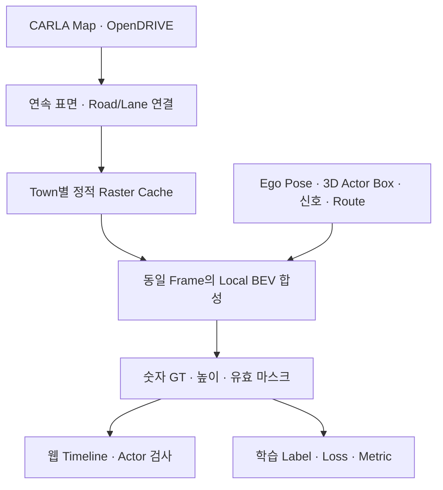

# Height-aware BEV 통합 사용·검증 보고

> 이전 v9 구현 기록입니다. 현재 기본 BEV는 제공한 전체 PNG를 직접 Crop·Rotation하는 방식으로 변경했습니다. 최신 사용법과 검증 범위는 [Global Map 통합 보고](GLOBAL_MAP_INTEGRATION_KO.md)를 확인하세요.

2026-10-12. SDV Studio v8을 기준으로 수집 → 숫자형 BEV 저장 → 시퀀스 탐색 → 기존 4개 BEV Head 학습을 연결했다. 실제 CARLA 0.9.15 **지도 API의 오프라인 검증**과 서버 없는 자동화 검증을 수행했다. GPU CARLA 서버의 실제 주행·센서 수집은 별도 미검증이다.

## 기존 코드 확인과 변경 근거

제공 LRS ZIP 두 개, HBLR 발표자료, 두 GitHub 저장소 및 HBLR README가 연결한 AGILEQ 수집 코드를 직접 확인했다. [소스·자료 조사 보고](BEV_SOURCES_KO.md)에 커밋, 함수, 캐시 해시, 라이선스와 구현 범위를 기록했다.

- LRS의 `make_local_bev_ego_aligned` 역방향 affine와 최근접 sampling을 재사용했다. 일부 다른 좌표 함수의 좌우 반전·정수화 보정은 가져오지 않았다.
- 확인 가능한 HBLR 연결 코드는 Town04/Town05의 높이 임계값에 따라 low/high PNG를 바꾼다. 연속 표면·토폴로지·Actor Ground Layer 판별은 그 소스에 없어 이번에 추가했다.
- 기존 지도 PNG에는 높이 validity, Road/Lane ID, 정확한 생성 버전이 없다. 특히 일부 Stop Line 이미지 크기가 다르다. 이 파일들을 새 metric 정답으로 무검증 승격하지 않고, 실제 CARLA Map/OpenDRIVE로 새 캐시를 생성한다.
- 기존 SDV는 Pygame MapImage와 Global tensor로 BEV를 만들며 차량 재생성 때도 정적 지도를 준비했다. 새 모드는 이 경로를 건너뛰고 Town별 해시 캐시를 재사용한다. `legacy` 모드는 남겼다.

## 새 구조



캐시는 전체 지도 크기의 큰 배열을 높이 개수만큼 복제하는 대신, 같은 Global 좌표계 위에 놓인 작은 **도로 표면 Patch**를 저장한다. Patch ID는 고정 Z 구간이나 층 번호가 아니다. 평면 도로를 이동해도 Patch ID는 바뀔 수 있으며, 도로 연결과 표면 높이는 연속으로 유지한다.

`metadata.json`, `metadata.sha256`, `world_offset.npy`, `layers/<patch>.npz`에 실제 도로 XYZ, Road/Section/Lane ID, topology, float32 높이, 정적 이진 mask를 보존한다. Town·OpenDRIVE 해시·해상도·생성기 버전·geometry 옵션이 다르면 캐시를 재사용하지 않는다. 누락되거나 불연속인 CARLA 지도 연결은 제외하고 원인·좌표를 `build_report`에 남긴다.

프레임 생성은 Ego의 접지 추정점과 실제 표면을 대조하여 시작 Patch를 찾고, Local 범위의 물리적 연결 거리로 겹치는 표면을 선택한다. 경사로를 고정 Z bin으로 끊지 않는다. 같은 높이라는 이유만으로 다른 연결 성분의 Actor를 합치지 않는다. 연결이나 높이를 확정하지 못한 영역은 invalid다.

이 연결은 **가시 표면의 연결**이며 차량의 통행 허가 그래프가 아니다. 실제 CARLA 좌우 차선 관계로 같은 Road/Section의 Shoulder·중앙분리대를 건너 같은 높이의 반대편 차도를 확인할 수 있으면 연결한다. 중간점의 높이도 검사하며, 분리대 공간 자체를 도로로 채우지 않는다.

## 좌표·Height 의미

| 항목 | 계약 |
|---|---|
| World | CARLA left-handed XYZ, m. X/Y 수평, Z 위쪽 |
| Global Raster | u는 World +X, v는 World +Y, 원점은 `world_offset` |
| Local Raster | Ego 전방은 위, 오른쪽은 오른쪽. Yaw 단위 degree |
| 기본 격자 | 500×500, 0.2 m/pixel, 약 100×100 m |
| Ego Anchor | `(width×anchor_x, height×anchor_y)`. 기본 `(250,250)` |
| Road Height | 연속 map surface에서 얻은 World Z, float32 m |
| Ground Contact | 변환된 Bounding Box 바닥면 중심에 근거한 추정. 실제 바퀴 접촉 센서 측정은 아님 |
| Ground Z | 해당 추정점에서 도로 표면을 찾아 얻은 Z |
| BBox Min/Max Z | 회전·이동된 실제 8개 Box 꼭짓점의 최저/최고 World Z |
| Object Height | `BBox Max Z − Min Z`, 즉 수직 점유 범위. Box local extent도 별도 기록 |

Pitch/Roll이 있는 Box는 모든 꼭짓점의 수평 투영 convex hull을 사용한다. 경사로의 긴 차량에는 위치별 도로 높이를 적용한다. Box의 상단 높이로 고가도로 소속을 정하지 않는다. 겹치는 객체의 이진 Occupancy는 합집합이며, ID raster는 상단이 높은 객체를 선택한다. 모든 객체 정보는 JSON에 독립적으로 남긴다.

Traffic Light는 CARLA의 실제 `get_stop_waypoints()`에서 얻은 차선 경계를 사용하고, 실제 Frame의 state로 Red/Yellow/Green mask를 만든다. 이 API로 확인할 수 없는 선은 임의 생성하지 않는다. Route는 현재 planner의 실제 waypoint이며 미래에 관측한 궤적과 구분한다.

## 저장 형식과 학습 호환성

각 Scene의 기존 RGB·Seg·Depth·Bounding Box·info 파일을 유지한다. 새 BEV는 동일한 Sample Key의 `bev_gt/<key>.npz`와 `info/<key>.json`의 `bev_gt`에 **schema_version 3**으로 저장한다. 기존 `das`, `lane`, `vehicle_mask`, `walker_mask`, `bev` PNG도 새 수치 배열에서 생성한다. PNG 색상은 학습 Class ID로 변환하지 않는다.

| 채널 | dtype / 의미 |
|---|---|
| `road`, `drivable`, `lane`, `road_boundary`, `sidewalk`, `junction` | uint8 0/1, 정적 map layer |
| `vehicle`, `pedestrian`, `cyclist`, `ego` | uint8 0/1, 독립 Occupancy |
| `stop_red`, `stop_yellow`, `stop_green`, `route` | uint8 0/1, 현재 Frame의 신호·계획 |
| `validity`, `lane_validity`, `occupancy_validity` | uint8 0/1, 의미별 유효성 |
| `elevation_m` | float32, 도로 World Z; 미확인은 NaN |
| `object_ground_z_m`, `object_min_z_m`, `object_max_z_m`, `object_height_m` | float32 m; 객체 없는/미확인 영역은 NaN |
| `actor_id`, `surface_id` | int32. 배경 Actor 0, 미확인 surface −1 |
| `semantic` | uint8 0~13, 독립 mask의 명시적 우선순위 합성 |

Semantic ID: 0 unknown/background, 1 drivable, 2 sidewalk, 3 junction, 4 road boundary, 5 lane, 6 route, 7 green stop line, 8 yellow, 9 red, 10 vehicle, 11 pedestrian, 12 cyclist, 13 ego. 중첩 정보는 독립 채널에 남으며 단일 semantic 이미지는 전체 정보를 대체하지 않는다.

기존 모델의 4개 Head(DAS/Lane/Vehicle/Walker)는 유지한다. 새 label만 물리 좌표로 기존 모델의 `[-20,20] m`, 0.2 m 격자에 sampling한다. 모델 tensor의 Y/X 순서와 웹의 전방-위 표시를 구분한다. 새 데이터의 실제 동일 Frame 센서 World Transform으로 camera optical 좌표를 Yaw 기준 BEV에 맞춘다. 보정 누락·Frame 불일치·구형/신형 데이터 혼합은 오류로 안내한다.

Invalid pixel은 Loss·Metric에서 제외한다. 수집에서 끈 채널을 0으로 학습하지 않도록 학습 선택/준비 검사도 제한한다. 높이·Actor·Surface 보조 tensor는 `get_bev_aux()`로 제공하며, 기존 모델 입력 채널이나 Head를 자동으로 늘리지 않는다. **Height 예측 Head는 추가하지 않았다.** 새 체크포인트에는 BEV 처리 계약을 추가하고, 기존 데이터셋의 재개 signature는 유지한다.

`studio/planning.py`의 export v2는 RGB/LiDAR 파일만 `inputs.files`에 넣고, BEV·info·Semantic/Depth/Box 라벨은 `simulator_ground_truth`로 분리한다. 미래 관측은 `targets`다. 현재 Ego/Navigation의 가용성도 실제 배포 환경에 맞게 검토해야 한다. TCP 전용 입력/Target 호환성은 주장하지 않는다.

## 웹 사용

1. `./start.sh`로 실행하고 **시뮬레이션 → BEV 생성 고급 설정**에서 mode·Width/Height·m/pixel·Anchor·높이 필터·Actor/정적 Layer·Overlay를 저장한다. 현재 실행 중인 작업은 시작 당시 설정을 유지한다.
2. CARLA를 연결하고 수집을 시작한다. 최초 Town 준비 시 캐시를 만들고 다음 수집부터 재사용한다. 생성 시간·높이·Road/Lane·유효 표면 비율·제외 원인을 확인한다.
3. 시퀀스 분석의 Frame Timeline으로 RGB/Seg/Depth/OD/BEV를 함께 이동한다. BEV 보기에서 Semantic, 도로 높이, 객체 높이, Occupancy, Road/Lane, Route를 선택한다. Actor 선택으로 Box·Ground Layer를 검사한다.
4. 학습 데이터 준비에서 Scene 단위로 분할한다. 새 NPZ·info·보정을 함께 복사한다. 학습 모니터의 실제 Prediction/GT에서 미확인 영역은 자홍색이다. 기존 데이터의 없는 높이는 N/A로 남는다.

### Offline 캐시 CLI

연구 Python에서 실행한다. 기존 연구 의존성의 CARLA 0.9.15, NumPy, OpenCV가 필요하다. 웹 환경에 CARLA/PyTorch를 추가 설치하지 않는다.

```bash
# 현재 연결된 Town의 캐시 생성. 실행 중인 월드를 바꾸지 않는다.
python -m sdv.bev build --host 127.0.0.1 --port 2000 --town Town04 --mpp 0.2

# 실제 OpenDRIVE 파일로 오프라인 생성. CARLA Python API만 필요하다.
python -m sdv.bev build --xodr /path/to/Town04.xodr --town Town04 --mpp 0.2

python -m sdv.bev inspect .runtime/bev/Town04/CACHE_HASH
```

위 경로의 `CACHE_HASH`와 XODR 경로는 실제 값으로 바꾼다. `inspect`는 캐시 metadata를 확인한다. 연결 서버 build는 실제 서버에서 아직 실행하지 않았으며, 오프라인 Map 및 같은 builder는 제공 XODR로 검증했다.

## 검증 기록

최종 자동화 결과와 측정 환경은 [BEV 검증 결과](BEV_VALIDATION_KO.md), 원자료 JSON은 `docs/validation/`에서 확인한다. LRS 실제 지도 비교 이미지 (local-only artifact: `validation/bev-lrs-actual-comparison.png`; not distributed / 로컬 검증 자료·미배포)는 원본 crop과 새 crop을 같은 Pose에서 비교한 것이다. 지도 자체의 paint 정답 정확도를 뜻하지 않는다.

Town04 동일 XY의 상·하부 도로 비교 (local-only artifact: `validation/bev-town04-overpass-reference-comparison.png`; not distributed / 로컬 검증 자료·미배포)는 LRS 원본, HBLR 연결 원본, 새 SDV 정적 정답과 도로 높이를 함께 보여 준다. 실제 OpenDRIVE와 제공 지도에서 생성했으며, 실제 RGB 수집 화면이나 학습 Prediction이 아니다.

수정 파일 전체와 기준 v8 대비 SHA-256은 `BEV_CHANGED_FILES.json`에 기록한다. 핵심 파일은 `sdv/bev/`, `sdv/collection/bev_adapter.py`, collection workflow/map 초기화, training data/loss/predictions/checkpointing, `studio/bev_preview.py`, sequence/catalog/dataset 준비·품질·planning, config/jobs 및 정적 웹 UI다.

## 남은 제한

- 실제 GPU CARLA 서버에서 RGB·Actor·BEV 동일 Frame 수집, 주변 객체 누락률, Stop Line paint 정렬, 장시간 FPS와 디스크 처리량은 미검증이다.
- Offline geometry는 실제 CARLA waypoint와 연속 표면 보간을 사용한다. 그래픽 도로 mesh/texture의 모든 pixel과 동일하다고 보장하지 않는다.
- Broken/복합 차선의 실제 dash 위상은 Waypoint만으로 확정할 수 없어 해당 support 영역을 `lane_validity`로 제외한다. 정확한 OpenDRIVE paint-object 처리나 실제 texture 대조는 후속 작업이다.
- 연결되지 않은 도로/보도 영역이나 모호한 Ground는 invalid다. 이것을 free space로 해석하면 안 된다. 연결 범위 밖에 있는 합법적인 주변 표면도 보수적으로 빠질 수 있다.
- Static obstacle·건물 mesh·정확한 roadside barrier는 이번 캐시에 포함하지 않는다. 미지원 layer를 가짜 선택지로 만들지 않았다.
- Actor Ground는 실제 물리 접촉값이 아닌 Box/Map에 근거한 추정이다. 점프·낙하·이상 자세·엔진의 collision mesh 차이는 실제 시뮬레이터에서 추가 검증해야 한다.
- 기존 PNG만 있는 데이터셋의 정확한 도로 높이·Actor bbox를 복원하지 않는다. 새 기능이 필요한 실험은 새 형식으로 수집해야 한다.
