# SDV Studio를 실제 사진으로 따라 하기

[소개](../README_ko.md) · [English](USER_GUIDE.md) · [환경 준비](SETUP_KO.md)

SDV Studio는 CARLA 기반 자율주행 연구용 프로토타입입니다. 사진은 화면 구성을 설명하는 예시이며 경로·설정·수치는 자신의 환경과 데이터에 맞게 선택합니다. **KO / EN**에서 화면 언어를 바꿀 수 있습니다.

## 1. 앱을 열고 환경을 설정합니다

`./start.sh`를 실행하고 `http://127.0.0.1:8765`를 엽니다. 왼쪽 **시스템 설정**에서 기존 CARLA 설치·연구 Python 경로를 입력하고 호스트·포트·데이터·결과 경로를 확인한 뒤 **시스템 설정 저장**을 누릅니다. **System Diagnostics**에서 실제 GPU·실행 환경을 검사합니다. **Off-screen · Epic**을 유지합니다. 프로파일 변경은 다음 엔진 실행부터 적용됩니다.

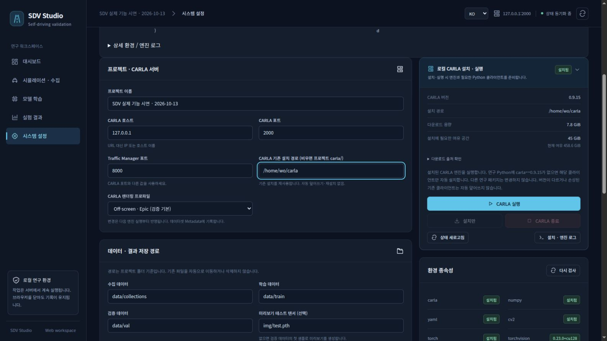

*자신의 PC에 설치된 CARLA와 연구 Python 경로를 지정합니다.*

## 2. CARLA와 수집·센서를 준비합니다

**시뮬레이션 → 수집 설정**에서 Town·샘플 수·카메라·주행 모드를 정합니다. Roach를 사용하려면 호환 체크포인트와 지도를 준비하고 모델 로딩 검사를 통과해야 합니다. 설정을 저장합니다. 기존 엔진이면 **CARLA 실행**, 설치가 없으면 **설치 후 실행**을 사용합니다. **Ready**가 된 뒤 **준비 상태 검사**를 누르고 누락 사유를 해결합니다.

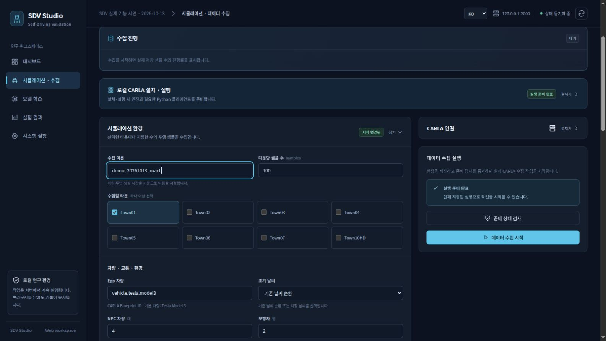

*Town과 저장 샘플 수를 정합니다. 저장 프레임 수와 시뮬레이션 Tick은 별개입니다.*

**센서 구성**에서 출력 종류·위치·회전·해상도·시야각을 정합니다. 필요하면 실제 센서 미리보기를 사용합니다. **미리보기에 적용**은 초안 확인이고, **센서 설정 저장**은 수집에 사용할 설정 저장입니다. 미리보기를 중지한 뒤 수집합니다.

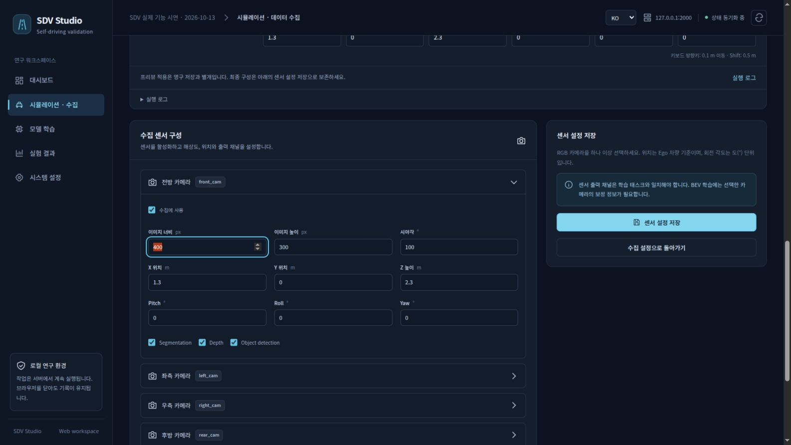

*위치·회전·해상도·시야각의 수치 설정이 수집 데이터의 보정을 정의합니다.*

## 3. 실제로 수집하고 저장 결과를 확인합니다

수집 화면으로 돌아가 **데이터 수집 시작**을 누르고 작업의 설정 사본을 확인해 시작합니다. 실제 저장 샘플 진행률과 RGB·BEV 미리보기를 봅니다. 끝나면 완료 상태·최종 샘플 수·로그를 확인합니다. 실패하면 저장 결과를 유지하고 엔진·작업 오류를 확인합니다.

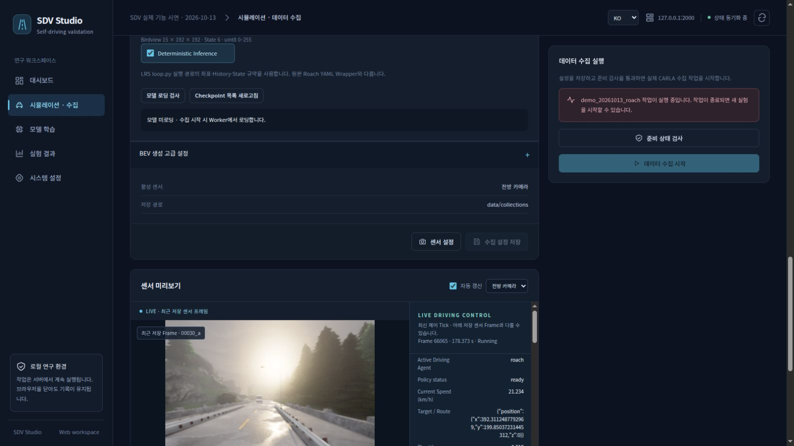

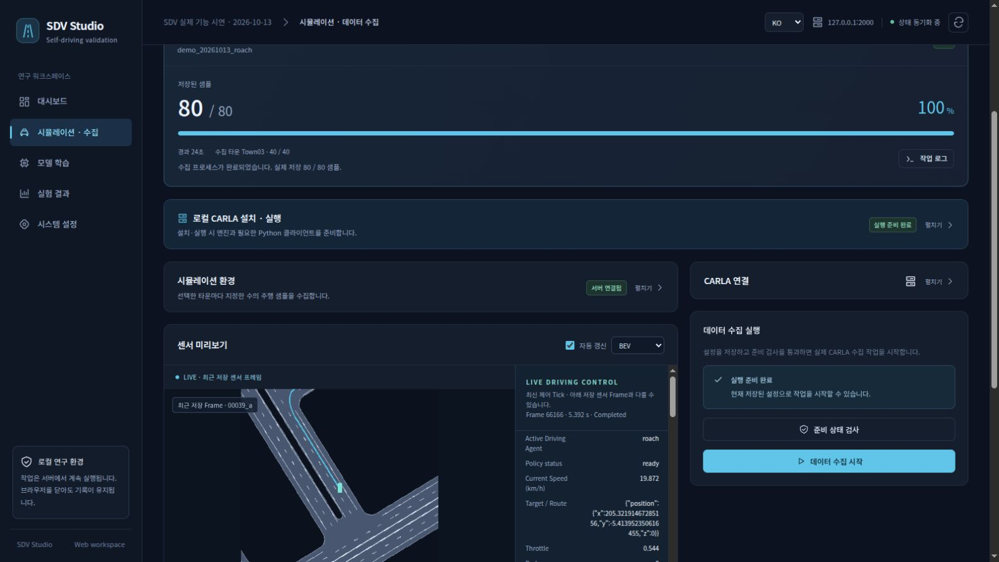

*완료 상태, 실제 저장 샘플 수와 로그를 확인한 뒤 데이터셋을 준비합니다.*

## 4. 장면을 분할하고 데이터셋을 재생합니다

**시퀀스 분석 · 데이터셋**에서 완전한 장면을 TRAIN·VAL로 지정하고 데이터셋 이름을 입력한 뒤 **데이터셋 준비**를 누릅니다. 원본과 당시 보정은 함께 보존·복사합니다. 인접 프레임을 무작위로 섞기보다 다른 장면으로 나눕니다. 완료 후 분할 샘플 수를 확인합니다.

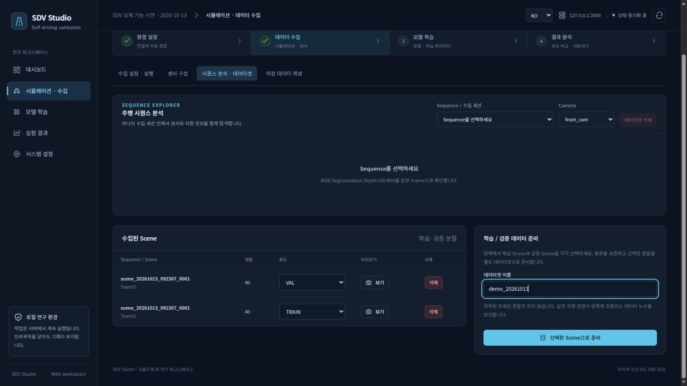

*서로 다른 장면을 TRAIN·VAL로 배정하고 원본 데이터를 보존합니다.*

Sequence와 Camera를 고르고 재생하거나 Frame 슬라이더를 움직입니다. 같은 Frame ID의 RGB·Seg·Depth·객체 주석·BEV가 정렬됐는지 확인합니다. 제공된 BEV 채널만 선택하고 노란 자산·높이 경고를 확인합니다.

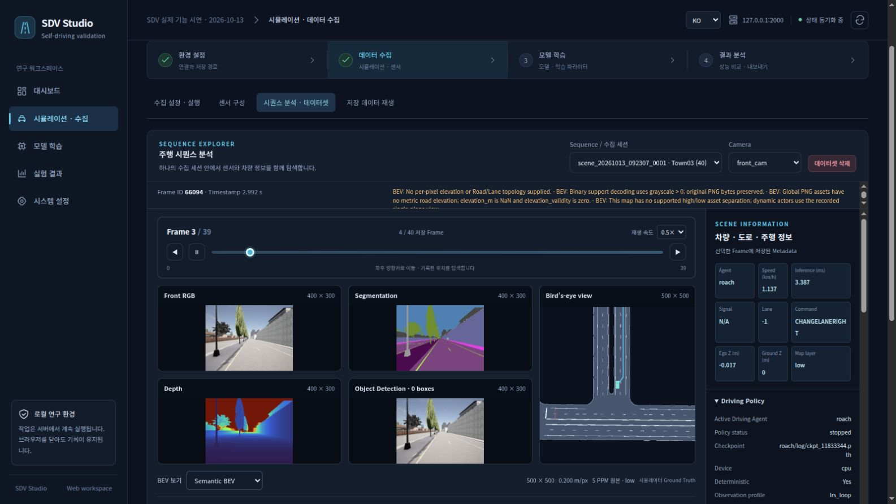

*실제 주석과 제공된 BEV 레이어를 확인합니다. 없는 정밀 도로 높이는 N/A입니다.*

## 5. 모델·태스크·손실·학습 설정을 정합니다

**모델 학습 → 설정**에서 준비한 TRAIN·VAL 쌍을 선택하고 보정·입력·라벨을 확인합니다. Encoder·Decoder를 정하고 데이터가 지원하는 태스크만 켭니다. 사용할 수 없는 선택에는 실제 누락 이유가 나타나며, 이 단계에서는 준비 상태가 아직 미완료일 수 있습니다.

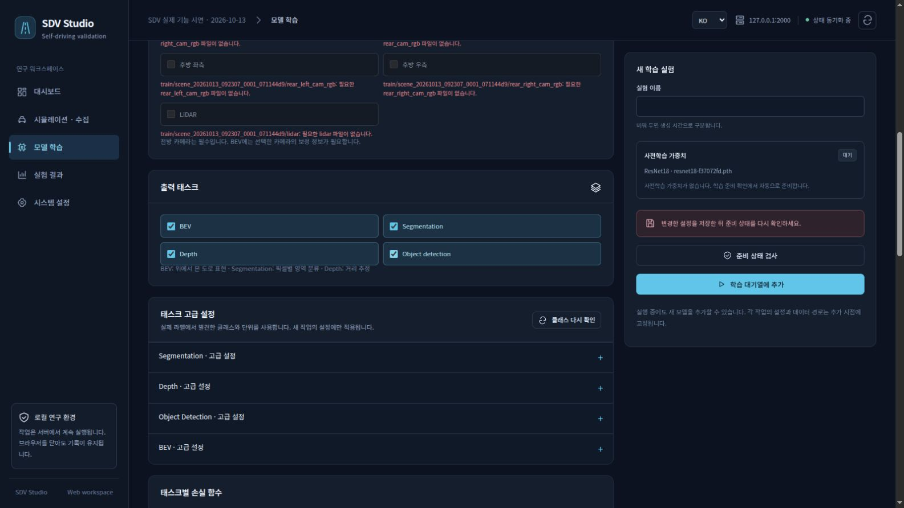

**태스크 설정**에서 관측된 Seg 클래스와 유효 마스크를 확인합니다. 태스크마다 지원하는 손실과 양수 가중치를 정하고, 클래스 추천은 변경 내용을 확인한 뒤 적용합니다. Epoch·Batch·학습률·Optimizer·입력 크기·예측 이미지 기록 주기를 정합니다. 저장 후 **준비 상태 검사**를 누르면 데이터·의존성·CUDA·선택한 공식 사전학습 가중치를 검사합니다. 일반 상태 조회만으로 가중치를 다운로드하지 않습니다. 준비가 완료되면 시작하거나 대기열에 넣습니다.

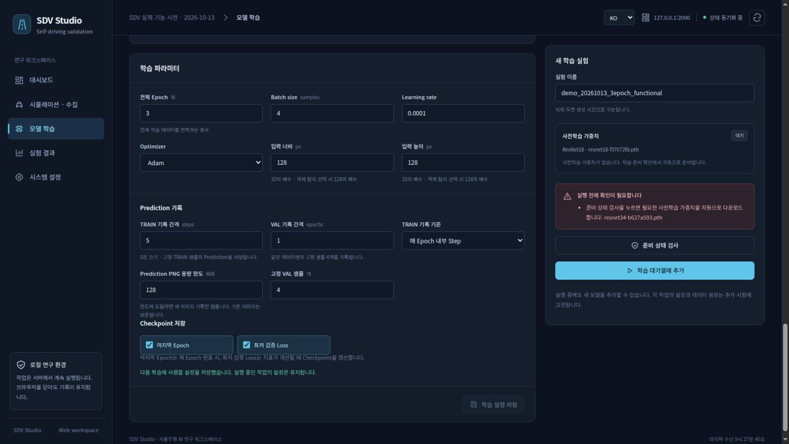

*태스크와 데이터에 맞는 학습 파라미터를 정하고 준비 검사를 실행합니다.*

## 6. 학습 진행과 체크포인트를 확인합니다

**모니터링**에서 실제 Epoch·Step·측정 ETA·로그·지표를 확인합니다. 대기열은 당시 모델·데이터·보정 설정 사본을 고정합니다. **일시정지**는 현재 Epoch 끝에서 멈추고 **재개**는 체크포인트에서 이어갑니다. **다시 시작**은 Epoch 1부터 새 작업으로 실행합니다. 중지한 작업을 이어하려면 호환되는 완료 체크포인트가 있어야 합니다.

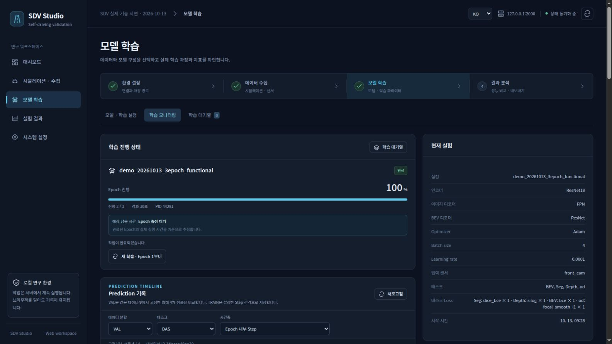

*Epoch·Step 진행과 체크포인트 상태를 확인한 뒤 작업을 이어갑니다.*

## 7. 예측 이미지와 지표를 탐색합니다

모니터링 또는 **실험 결과**에서 실험·TRAIN/VAL·표본·태스크를 선택합니다. **입력 / 정답 / Prediction**을 함께 봅니다. Epoch·Iteration 슬라이더로 실제 저장된 위치만 이동합니다. 없는 Step의 예측을 만들어 표시하지 않습니다. VAL 표본은 데이터 내용별로 고정하며, 실험 비교에는 일치하는 데이터셋 fingerprint가 필요합니다.

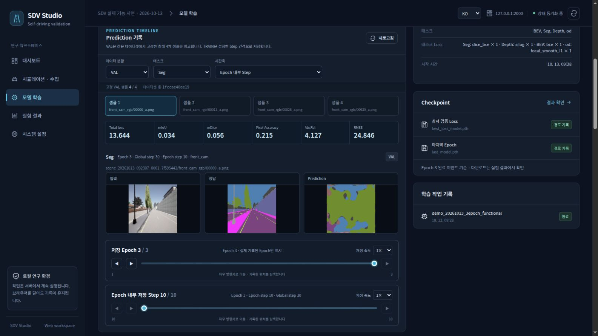

Loss 그래프와 태스크 지표 표에서 **TRAIN / VAL** 범례와 지표의 좋고 나쁨 방향을 확인합니다. Best에는 해당 Epoch가 남습니다. 실험 결과의 설정, `train_metrics.csv`, 예측 이력, Best·Last 체크포인트를 확인합니다. 대기열 삭제는 결과를 보존합니다.

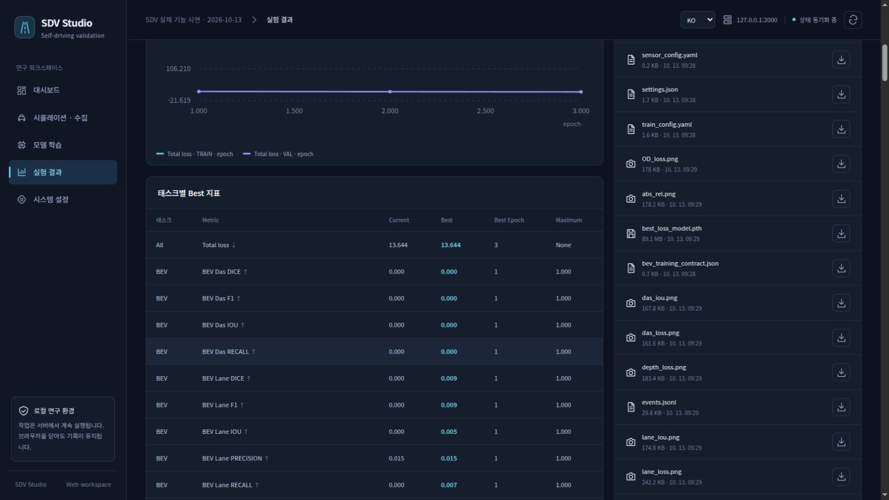

*검증 분할과 실제 라벨을 기준으로 지표를 해석합니다. 화면의 값은 예시입니다.*

지원 선택값과 프로토타입의 범위는 [모델·학습 설정](MODELS_KO.md), [BEV 계약](GLOBAL_MAP_INTEGRATION_KO.md), [환경 준비](SETUP_KO.md)를 참고하세요.
