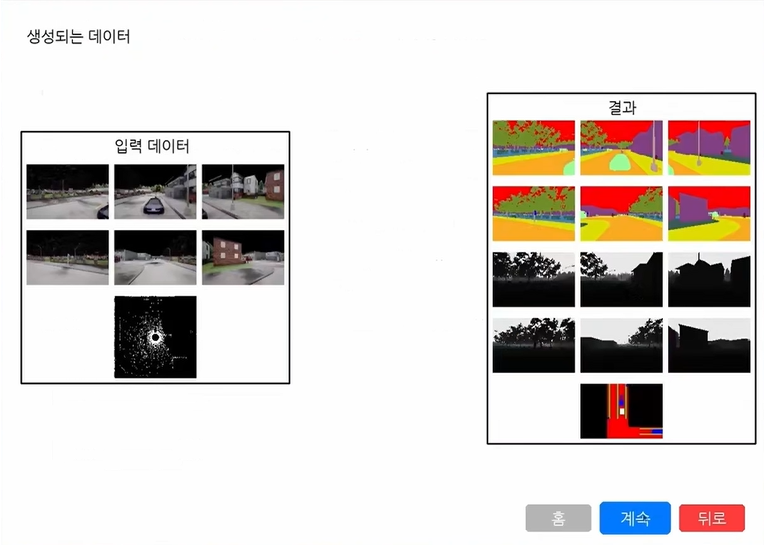
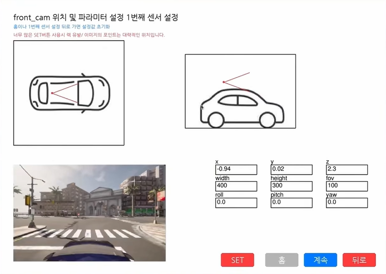
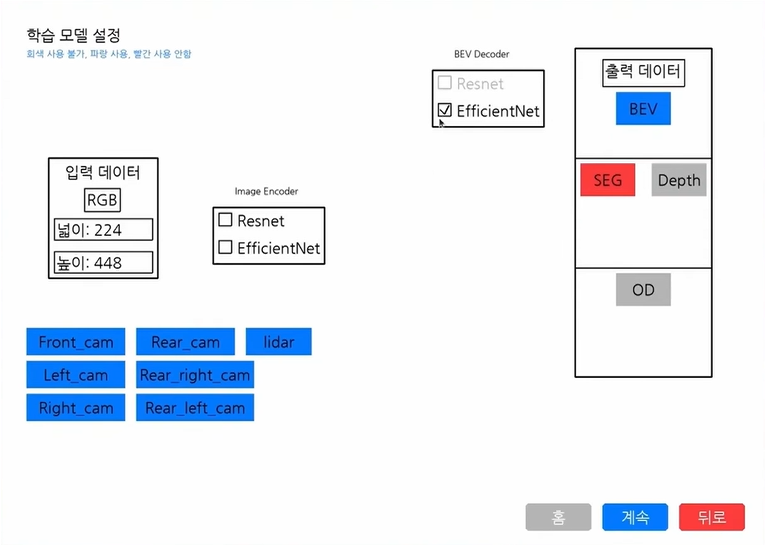
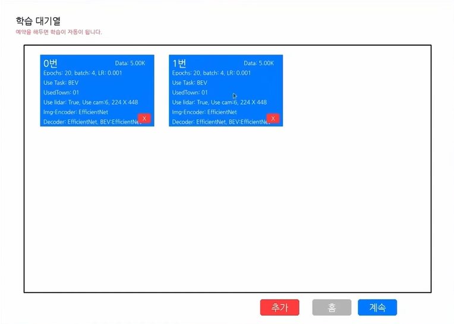
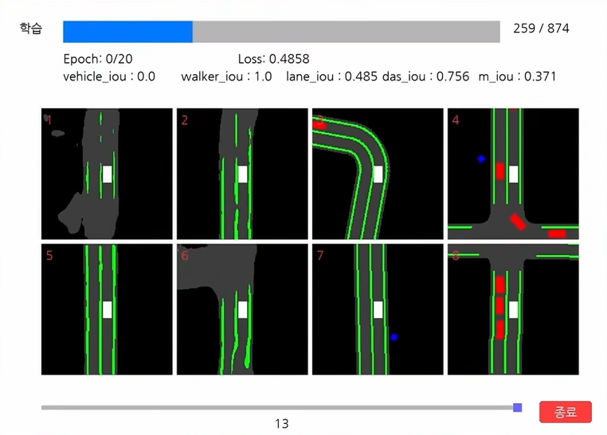

> 창·글자 개선: 전체 화면 확대를 제거하고 실제 창 해상도에 한글을 직접 그립니다. 이번 UI 검증·미실행 범위 (local-only artifact: `docs/qa/ui-responsive-20261006/REPORT.md`; not distributed / 로컬 검증 자료·미배포).

> 2026-10-06 구조 정리: 구현은 `sdv/ui·config·runtime·collection·training` 아래에 묶었습니다. 기존 실행 명령은 유지합니다. 파일 구조·테스트·복구법 (local-only artifact: `docs/layout.md`; not distributed / 로컬 검증 자료·미배포). 새 버전 검증은 docs/qa/refactor-20261006에 별도로 기록합니다.

> 2026-10-06: 기본 수집 수 문자열에 의한 대기열 TypeError와 actor 정리 순서를 수정했습니다. 재현·검증 기록 (local-only artifact: `docs/qa/bugfix-20261006/REPORT.md`; not distributed / 로컬 검증 자료·미배포). 기존 설정 파일을 지우거나 aa를 다시 설치할 필요 없이 ./start.sh로 다시 실행하세요.

# SDV_V1 실행 안내 · 2026-10-06

현재 로컬 작업은 Git `ad67aa1f412c7428a2a126fe9c00a1726b94d693`에서 시작했습니다. 기존 Pygame 화면과 설정 → 수집 → 학습 → 결과 확인 구조를 유지하며 한국어 안내, 입력 검사, 공통 상태·중지·재시작 흐름을 개선했습니다.

## 바로 실행

```bash
cd /home/wo/SDV_V1
./start.sh
```

GUI가 있는 현재 데스크톱 세션에서 실행하세요. 창을 닫거나 상단 **중지**, **홈**, Esc를 누르면 이번 SDV에서 시작한 프로세스와 센서를 정리합니다. 상태 표시줄을 누르면 잘린 오류 내용을 펼쳐 볼 수 있습니다. Tab/Shift+Tab과 Enter로 주요 버튼을 이동·실행할 수 있습니다.

이미 `.venv`가 준비돼 있습니다. aa는 Python 3.9.25와 기존 라이브러리를 읽기만 사용했고, Pygame 2.6.1과 webcolors 24.11.1만 프로젝트 환경에 설치했습니다. 환경을 다시 만들 필요가 있을 때만 아래 명령을 사용하세요. 전역 aa에 설치하지 마세요.

```bash
cd /home/wo/SDV_V1
/home/wo/anaconda3/envs/aa/bin/python -m venv --system-site-packages .venv
HOME="$PWD/.runtime/home" PIP_CACHE_DIR="$PWD/.runtime/cache/pip" .venv/bin/python -m pip install -r requirements-ui.txt
```

## 창 크기와 화면 이동

기본 창은 1280×820이며 실제 데스크톱의 가용 크기에 맞춰 열립니다. 작은 창에서는 내용 영역만 스크롤하고 하단 행동 버튼과 상태 표시줄은 유지합니다. 창을 확대해도 글자 전체를 그림처럼 확대하지 않습니다. 기본 지정 크기는 제목32/섹션24/본문18/보조16px이며 실제 glyph 높이는 글꼴에 따라 다릅니다.

- 마우스 휠: 현재 화면의 내용 이동. 입력과 버튼은 화면에 그린 위치에서 반응합니다.
- Ctrl++ / Ctrl+-: 글자와 간격을 90~150%로 변경. Ctrl+0: 기본 크기 복원.
- Tab / Shift+Tab: 제어 이동, Enter 또는 Space: 실행. 입력 도중 Tab은 먼저 현재 입력을 검증합니다.
- 상태 표시줄 클릭: 전체 오류/긴 경로를 펼쳐 읽기. 상세 안에서 휠로 이동하고 Esc로 닫습니다. 일반 화면의 Esc는 작업 정리 후 홈으로 돌아갑니다.
- 긴 텍스트는 픽셀 폭에 맞춰 줄바꿈하거나 말줄임합니다. 잘린 항목은 마우스를 올려 원문을 확인할 수 있습니다.

이번 UI 작업은 CARLA·학습·수집·다운로드를 실행하지 않았습니다. 이 과정은 기존 실행 예산과 준비 검사를 그대로 사용하며, 표시 fixture 화면을 모델 성능이나 실제 GPU 실행 증거로 사용하지 않습니다.

## 처음 진행할 순서

1. **센서 설정과 데이터 수집**에서 Town01, 전면 카메라, 수집 수 3으로 시작합니다. 숫자·타운·카메라를 검사하고 설정을 저장합니다.
2. 설정 검토 화면은 저장소의 예시 이미지입니다. **센서 확인**을 누르면 실제 CARLA가 시작됩니다. 연결 상태를 기다린 뒤 위치·시야각을 조절합니다. 숫자는 Enter로 적용하고 **적용**으로 센서를 다시 만듭니다.
3. **수집 시작**으로 실제 데이터를 저장합니다. 기본 위치는 `data/Town*/scene_<실행시각>_*/`이며 기존 장면을 덮어쓰지 않습니다. 수집 파일 수와 종료 로그를 확인합니다. 중지해도 저장된 파일은 남습니다.
4. **모델과 학습 설정**에서 학습률·배치·에포크·옵티마이저와 모델 출력을 선택하고 대기열에 넣습니다. **준비 검사**는 설정을 저장하고 필수 자료를 검사합니다. 조건이 모두 충족되면 기존 `train2.py`로 연결됩니다.
5. **저장된 결과 확인**은 `Training_result/`의 실제 저장 결과를 읽습니다. 결과가 없으면 안내를 표시합니다. 미완성 DEEPX와 독립 예측 실행을 활성 기능으로 제공하지 않습니다.

## 실행 제한과 로그

- UI: CPU 1개 분량, RAM 2GiB, swap 0, nice 10, 20FPS.
- CARLA: CPU 4개 분량, RAM 8GiB, swap 0, Low, offscreen 640×360, 10FPS, 실행당 최대 90초. 선택 타운을 초기 URL로 요청하고, UI에서 실제 맵이 다르면 load_world로 불러옵니다. 초기 URL만으로 선택맵 적용이 보장되지는 않습니다.
- CARLA와 수집·학습 작업은 각각 소유한 사용자 systemd scope로 관리합니다. 수집/학습 Python은 CPU 1개 분량·RAM 2GiB·최대 90초입니다. 반복 시작은 활성 작업을 중복 생성하지 않습니다.
- GPU 시작 전 여유 8GiB를 확인합니다. VRAM은 하드 제한이 아닌 6GiB 증가량 감시로 중단합니다. 그래픽 프로세스 누락을 고려해 PID 사용량과 GPU 전체 증가량을 함께 봅니다. 다른 GPU 작업이 늘면 보수적으로 중단될 수 있습니다.
- 90초 제한에 도달하면 상태와 로그를 표시합니다. 이 설정은 짧은 검증용이며 장시간 수집/학습 완료를 보장하지 않습니다.
- 로그: `.runtime/logs/` (CARLA·collection·training 로그, `connection.log`, `preview-worker.log`, `process-events.jsonl`, `ui-errors.log`). 캐시·임시파일·모델 캐시는 `.runtime/` 안에 둡니다. 다른 CARLA나 Python 프로세스를 일괄 종료하지 않습니다.

## CARLA 자산과 다운로드

현재 `carla/`는 기존 로컬 CARLA 0.9.15 배포를 독립 복사한 30GB입니다. 원본과 복사한 Shipping 실행 파일 SHA256이 일치합니다: `1da989e4ff136e0658fdea421bc1da2b0e5cb018c6e767efc4f6129c21ab1a81`. VERSION·LICENSE·README·Python wheel은 공식 배포 구조와 일치하지만, 원본 다운로드 영수증이나 공식 체크섬으로 출처를 암호학적으로 검증한 것은 아닙니다.

CARLA가 없을 때 수집 진입은 공식 기본 배포 설치를 시작합니다. [공식 0.9.15 릴리스](https://github.com/carla-simulator/carla/releases/tag/0.9.15)의 [Linux 기본 배포](https://downloads.carlasim.com/Linux/CARLA_0.9.15.tar.gz)는 8,386,636,048 bytes (7.81GiB)이며, 설치 전 여유 45GiB를 확인합니다. 설치 화면에서 진행률·취소·재시도를 제공합니다. `.runtime/downloads/*.part`를 이어받고 안전한 tar 필터로 임시 폴더에 해제한 후 버전을 검사합니다. 기존 carla 파일은 덮어쓰지 않습니다. 추가맵 7,375,946,087 bytes는 자동 다운로드하지 않습니다. 이번 작업에서는 대용량 다운로드를 실행하지 않았습니다.

Low 옵션은 [CARLA 0.9.15 공식 파서](https://github.com/carla-simulator/carla/blob/0.9.15/Unreal/CarlaUE4/Plugins/Carla/Source/Carla/Settings/CarlaSettings.cpp#L139)의 `-quality-level=Low`를 사용합니다. 기존 `-quality_level=Low` 오타와, 서버 준비 전에 생성한 RPC client를 계속 재사용하던 연결 문제를 수정했습니다.

## 검증 범위와 학습 준비

실제 X11 창, CARLA 0.9.15 연결·카메라 수신, 선택 Town01, 별도 시험 폴더의 RGB 3장/info 3개 저장·정상 종료를 확인했습니다. 시험 경로는 `data/qa_collection/20261005_144844/`이며 학습 분할로 사용하지 않았습니다. 증거는 검증 기록 (local-only artifact: `docs/qa/EVIDENCE.md`; not distributed / 로컬 검증 자료·미배포), [진행 기록](PROGRESS.md), `docs/qa/*.png`에 있습니다.

현재 실제 학습은 `data/train`, `data/val`, 호환 `img/test.pth`, 선택 인코더의 로컬 사전학습 가중치가 없어 차단됩니다. 자료를 임의로 만들거나 자동 모델 다운로드하지 않습니다. 세 시험 이미지를 학습·검증 데이터로 재활용하지 않았습니다. 모델 전체 텐서 호환성, 학습/예측 성능과 결과 시각화의 모든 태스크 조합은 미검증입니다.

```bash
.venv/bin/python -B train.py --check
.venv/bin/python -B tests/test_safety.py
SDL_VIDEODRIVER=dummy .venv/bin/python -B tests/ui_scenarios.py
```

`--check`는 준비 파일이 없으면 JSON 사유와 종료 코드 2를 반환합니다. 안전 검사는 작은 mock 응답으로 다운로드 실패·취소·재개와 압축 경로 탈출을 검사합니다. 실제 7.81GiB 전송·전체 해제는 미실행입니다. `tests/live_preview.py`와 `tests/tiny_collection.py`는 GPU를 사용하는 명시적 실검증 도구이므로 다른 CARLA 작업과 조율한 뒤 실행하세요.

---

## 원래 저장소의 연구 배경과 이전 시연

아래는 기존 README 내용입니다. 개발 당시 결과와 이번 로컬 검증 범위를 구분해서 읽어 주세요. 실행 방법과 현재 한계는 위 안내를 우선합니다.



# SDV

[English](README.md)

KETI 재직 당시 수석 연구원의 제안으로 시작해 약 3개월간 단독 개발한 자율주행 연구 플랫폼의 프로토타입입니다. **개발 당시 설정 → 데이터 수집 → 모델 학습 → 결과 확인으로 이어지는 기본 흐름을 구현하고 실행했습니다.** CARLA 센서 설정과 멀티모달 데이터 수집, 모델 구성, 학습 및 결과 확인을 데스크톱 UI로 다뤄 인지 모델 실험을 쉽게 구성하고 비교하는 환경을 만들었습니다.

보유한 FMTC CARLA 맵까지 연동하는 연구 환경으로 확장하려 했습니다. 공식 연구 과제로 진행된 것은 아니며, 퇴사로 개발이 중단되어 확장 기능과 일부 연동이 미완성 상태로 남아 있습니다.

> **기본 흐름이 동작했던 연구 프로토타입의 공개 소스입니다.** 현재 공개 버전에는 파일·설정 경로·의존성 등 재현을 위해 정리할 부분이 남아 있습니다. 개발 당시의 실행 경험과 별개로, 이번 공개 버전의 전체 실행 과정은 다시 검증하지 않았습니다.

**지원 언어:** 현재 프로그램 버전은 한국어만 지원합니다.

## 데모

- [SDV UI 시연](https://youtu.be/Y6UTaquOltg)
- [FMTC 지도: LiDAR 4대 융합 시연](https://youtu.be/UsxVp50MeAM)

영상과 이미지는 이전 시연 화면입니다. 현재 공개한 코드로 시연의 모든 기능을 재현할 수 있다는 의미는 아닙니다. 화면에 표시된 수치도 이번 버전에서 검증한 벤치마크 결과가 아닌 당시 실험 예시입니다.

## 구현하고 실행한 기본 흐름

1. CARLA 타운, 카메라, LiDAR를 선택합니다.
2. 센서 위치·방향, 이미지 크기, 시야각을 설정합니다.
3. RGB, 세그멘테이션, 깊이, 객체 주석, BEV 데이터를 생성하고 확인합니다.
4. 모델 구성 요소와 학습 태스크를 선택하고 학습 파라미터를 설정합니다.
5. 실험을 대기열에 넣고 학습 진행·예측을 확인한 뒤, 저장된 결과를 비교하고 재학습합니다.

아래 한계는 현재 공개 소스의 실행 연결과 재현성에 관한 내용입니다.

| 영역 | 현재 코드에 포함된 구성 요소 | 공개 버전에서 정리할 부분 |
| --- | --- | --- |
| 데스크톱 UI | 센서 설정, 데이터 확인, 모델 선택, 학습 대기열, 결과 화면 | UI 동작과 백엔드 실행 경로가 완전히 연결되지 않음 |
| CARLA 데이터 생성 | 센서 래퍼, 내비게이션 도우미, 장면 생성, 멀티모달 출력 | 호환되는 CARLA 서버와 로컬 환경 필요 |
| 인지 모델 | EfficientNet/ResNet 인코더, BEV 투영, FPN/BiFPN, 선택적 PointPillar 특징, 태스크별 헤드 | 학습과 태스크 조합별 디버깅 필요 |
| 학습 실험 | `train2.py`, 객체 검출 실험용 `trainx2.py` | UI 학습 진입점 누락, 설정 경로 불일치, 하드코딩된 값 |
| 결과 확인 | 로컬 로그·지표 저장과 예측 표시 코드 | 호환되는 생성 결과와 저장 텐서 필요 |

### 센서 설정



### 모델·학습 설정





### 학습 과정 확인



## 추후 연구 계획

CARLA 실험 UI에서 출발해 시뮬레이션, 합성 데이터, 평가, 배포를 연결하는 연구 환경으로 확장하려는 계획입니다. 아래 항목은 연구 방향이며 이번 버전에서 전체 파이프라인을 구현한 것은 아닙니다.

| 방향 | 계획 |
| --- | --- |
| 경량 2D BEV 시뮬레이션 | 별도 프로젝트인 [LRS (Low Resource Simulation)](https://github.com/junwoomin/LRS)에서 개발을 진행하던 경량 BEV 시뮬레이터. Ackermann 운동학 모델을 활용해 낮은 시뮬레이션 비용으로 주행 행동과 장면 생성을 연구 |
| CARLA 검증 | LRS에서 생성한 장면 중 선택한 장면을 CARLA에서 검증하고, 장시간 CARLA 데이터 생성에 대한 의존도를 줄이면서 연구 환경의 활용성을 높이는 방향 탐색 |
| 스타일 변환·데이터 증강 | UniScene에서 영감을 받아 실제 데이터나 다른 시뮬레이션의 시각적 스타일을 반영하는 스타일 변환(style transfer)과 데이터 증강(data augmentation)을 접목하고, 다양한 환경에서 강건한 인지 모델을 학습할 수 있도록 확장하려던 구상 |
| BEV 조건부 생성 | BEV 장면을 조건으로 카메라 이미지·영상, 3D occupancy, LiDAR를 생성하고 장면 변이를 제어하는 방법 연구 |
| 데이터셋 평가 | CARLA·nuScenes에서 인지 성능을 비교하고 생성 데이터의 학습 효과 평가 |
| W&B 연동 | Weights & Biases로 실험 추적·분석, 하이퍼파라미터 탐색, 결과 저장·공유 |
| DEEPX·SDV-RUN | 호환 모델의 DEEPX 변환을 연구하고, 별도 실행 환경에서 예측·제어로 연결 |

생성 데이터의 사실성, 기하·시간 일관성, 실제 데이터로의 전이는 검증할 연구 과제입니다. 합성 데이터가 실제 데이터와 동등하거나 배포 경로가 이미 작동한다고 주장하지 않습니다.

이미지와 웹캠 입력으로 예측을 확인하는 인터페이스도 구상에 포함됩니다. 독립적인 예측 실행 흐름은 아직 완성되지 않았습니다.

[연구 계획과 제안 구조](../research-plan_ko.md)

## 코드 구성

| 경로 | 역할 |
| --- | --- |
| `start.py` | 데스크톱 UI와 실험 설정 |
| `carla_run.py` | CARLA 실행과 장면·센서 데이터 수집 |
| `sdv/collection/carla_engine/` | 월드·센서·내비게이션·BEV 렌더링 도우미 |
| `sdv/training/modeling/` | 데이터 로더, 모델, voxel/pillar 처리, 손실 함수 |
| `train2.py`, `trainx2.py` | 실험용 학습 스크립트 |
| `sdv/ui/widgets.py`, `sdv/runtime/`, `sdv/collection/` | 화면·프로세스·센서 도우미 |
| `config/examples/sensor_config.yaml` | 센서·타운 설정 예시 |
| `img/` | 작은 UI 이미지와 센서 데이터 샘플 |
| `docs/` | 연구 계획, 개발 메모, 화면 이미지 |

## 공개 원본의 실행 전 확인 기록

아래 내용은 가져온 공개 원본의 제한 사항입니다. 현재 SDV_V1에서는 누락된 호환 진입점과 경로·설정 오류를 수정했고, 로컬 UI/짧은 CARLA 수집의 검증과 아직 수행하지 않은 실제 학습을 위 안내 및 PROGRESS.md에 구분해 기록했습니다.

[개발 메모](../development_ko.md)를 먼저 확인하세요. 기존 `requirements.txt`에는 누락된 의존성이 있고 UI의 자동 설치 버전과도 다릅니다. 동작하는 환경을 재구성하거나 실행 검증을 마친 버전이 아닙니다.

확인된 문제에는 UI가 호출하는 `train.py` 누락, UI·학습 스크립트의 설정 경로 불일치, CARLA 버전 불일치, 공개 대상에서 제외한 저장 테스트 텐서가 있습니다. Python 문법 검사는 통과했지만 import와 실제 실행을 검증한 것은 아닙니다.

캐시, 복사본, 현재 실행 경로와 연결되지 않은 구형 모듈, 노트북, 대용량 저장 테스트 텐서는 공개 대상에서 제외했습니다. UI가 사용하는 작은 이미지·데이터 샘플은 유지했습니다. 확인한 공개 대상 파일에서는 하드코딩된 API 키·토큰·비밀번호·개인 키를 발견하지 못했습니다.

## 라이선스

[MIT](../../LICENSE). 내비게이션 코드에 있는 CARLA 저작권·라이선스 표기를 유지합니다.
